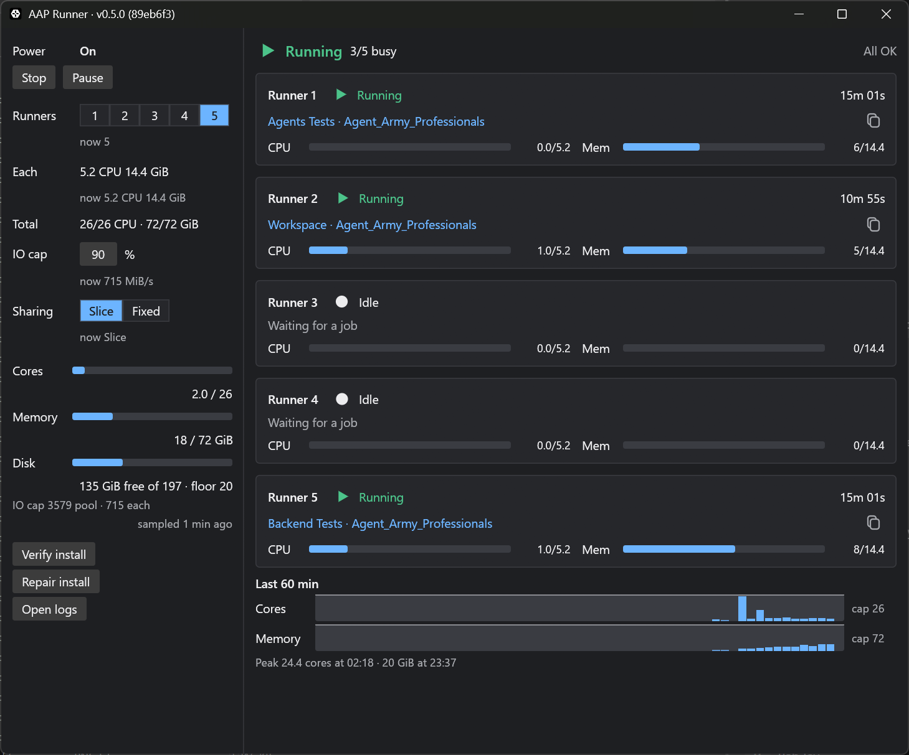

# aap-runner

Ephemeral self-hosted GitHub Actions runners for a Windows PC. Each job runs in a
fresh Sysbox container inside a locked-down WSL 2 distro, and the runner registers
through a GitHub App.

## The three parts

| Part | Where | What it does |
|---|---|---|
| Distro manager | `distro/` | Bootstrap for the `aap-runner` WSL distro (Docker Engine, Sysbox, nftables, work disk) and `manager.sh`, the systemd service that starts one ephemeral runner container per job. |
| Host supervisor | `supervisor/` | PowerShell scheduled task that starts, stops, pauses and resizes the distro from small files under `C:\ProgramData\aap-runner`. |
| Tray | `crates/tray/` | Rust tray app that shows runner state and writes the supervisor's inbox. It never runs `wsl.exe` and needs no token. |

`installer/` holds the host installer (`install-host.ps1`) and the work-disk scripts.
`tests/` holds the bash tests for the manager and units (`bash tests/run.sh`).
`distro/README.md` is the full design, install and evidence guide.

The binaries and scripts are not code-signed: SmartScreen will warn once.

## Licence

MIT. See `LICENSE`.
