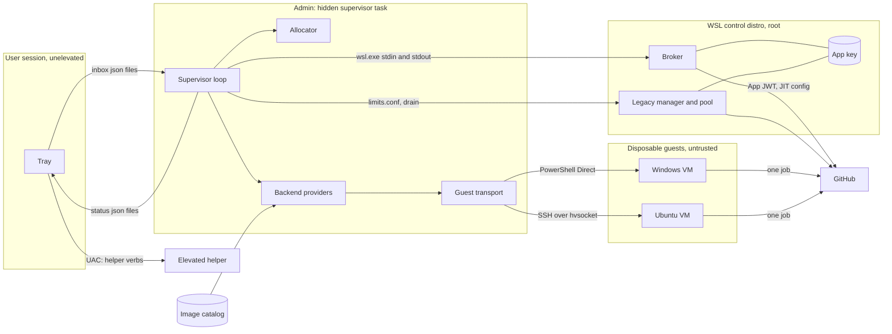
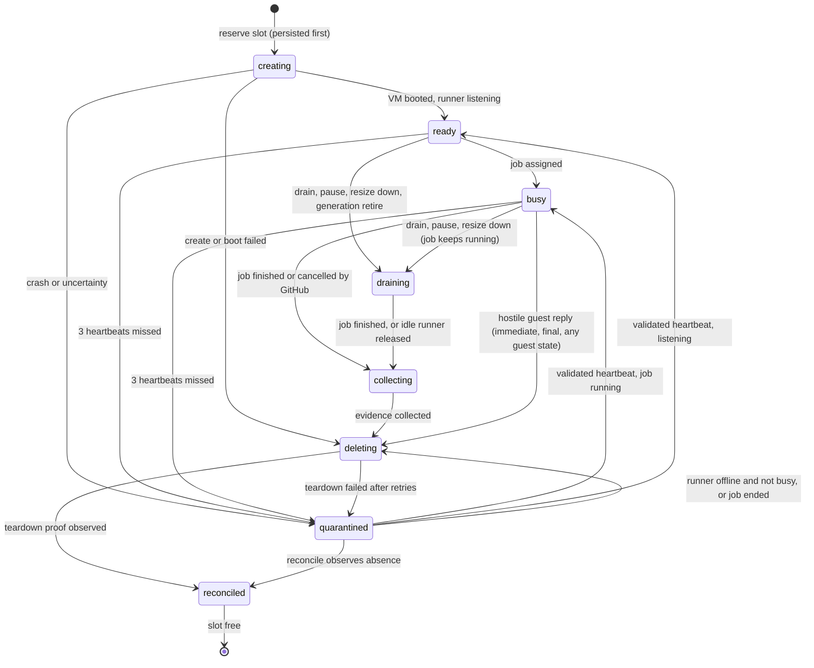
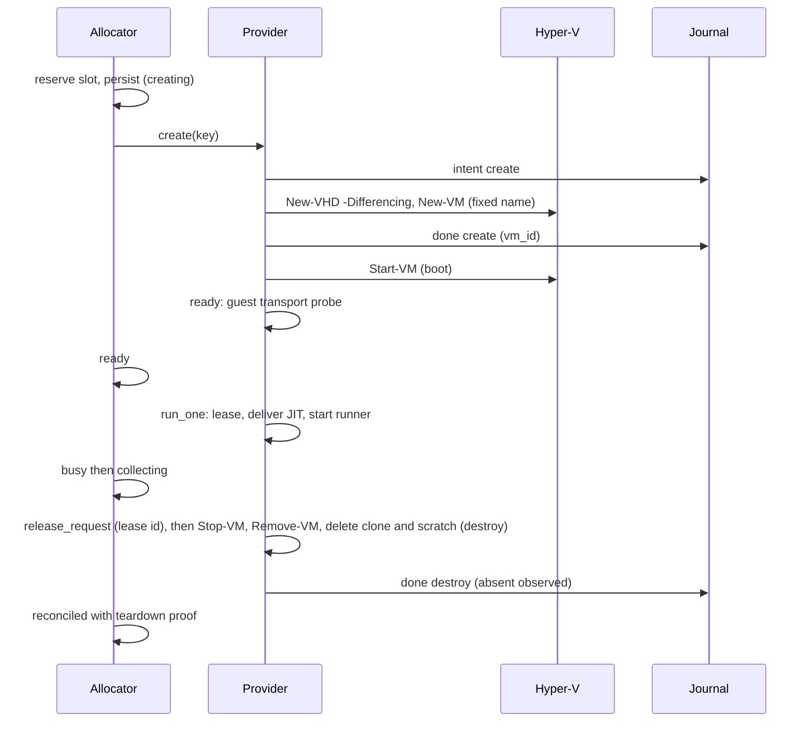
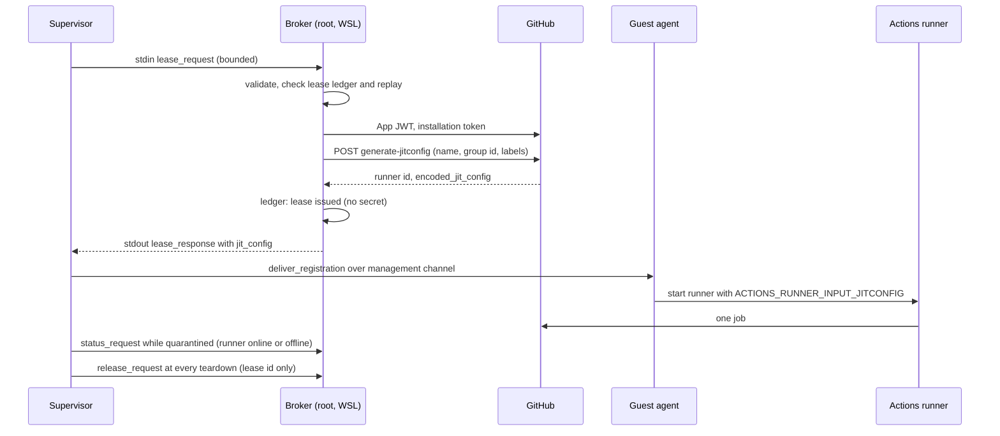
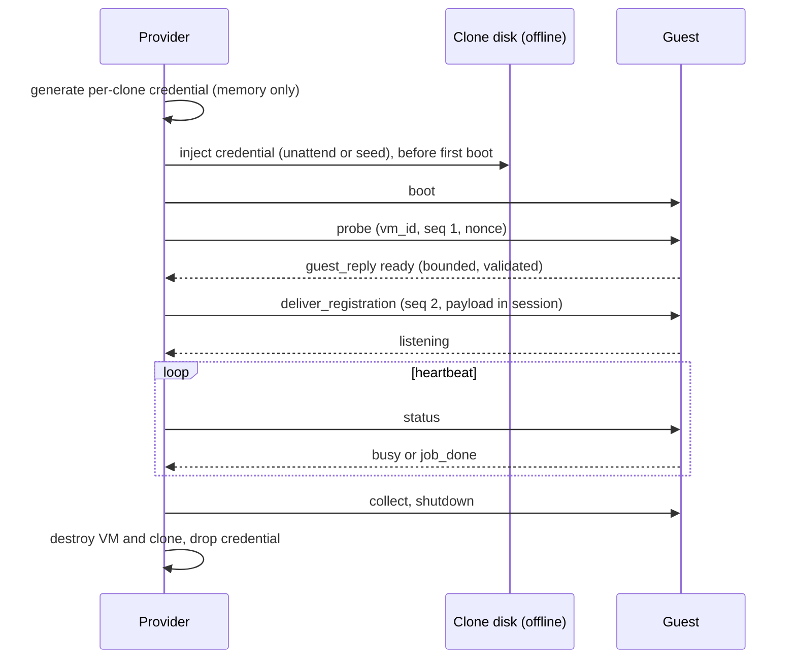
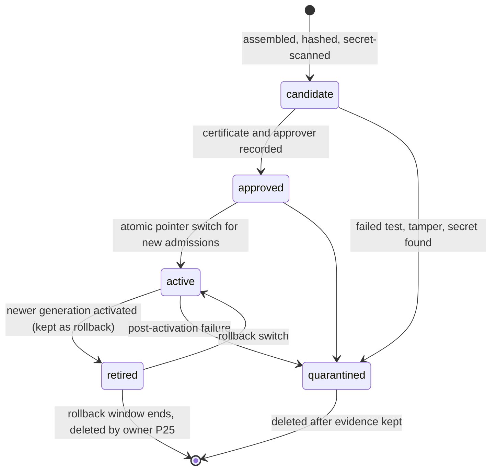
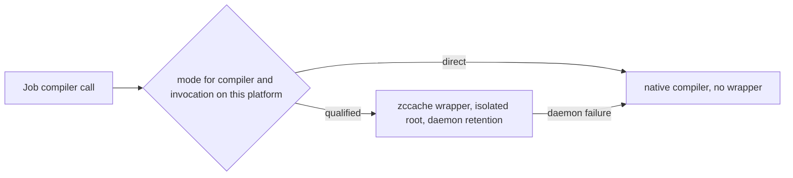
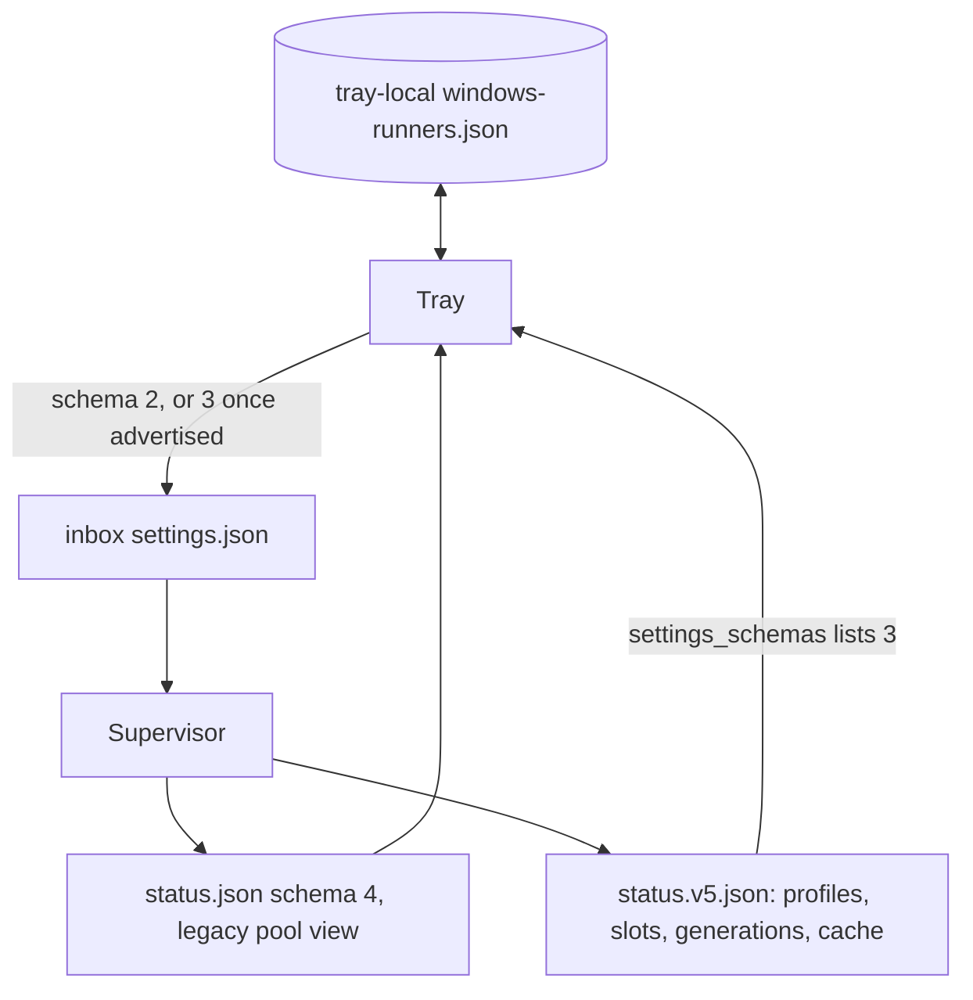
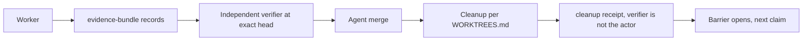

# Parity architecture (frozen by P02)

Revision 1, 2026-10-19. Ledger item P02. This document freezes the components, trust
boundaries, data flows, state machines and failure handling that every later parity
item builds on. The machine-checkable shapes live in [`parity/contracts/`](../../parity/contracts/README.md);
`python -I parity/contracts/validate.py` checks every example and negative fixture.

Every rule below carries one marker:

- **DECIDED**: frozen. A later item that needs a change files a ledger revision first.
- **CANDIDATE (D2)**: the chosen mechanism, not yet proven. It stays a candidate until the
  lab plan in [guest-transport.md](../../parity/contracts/guest-transport.md#lab-proof-plan-p021-executed-for-p08-p10-p11)
  passes in an owner-authorized disposable lab (gate D2). Gate D2 is partly met: the lab host
  is this machine with Hyper-V enabled, and the owner provides a Windows Server 2025 Evaluation
  ISO (180-day). The compute and storage budget is still to be measured and approved before any VM.
- **RESOLVED 2026-10-19**: the owner decisions this item first left open (labels, image volume,
  distro uptime, reserve floor, D2 media). See
  [the contracts README](../../parity/contracts/README.md#resolved-2026-10-19).

Nothing here was provisioned, enabled or run against the live install. No VM was created.

## 1. Components and trust boundaries

| Component | Runs as | Trust | Owns | Never does |
|---|---|---|---|---|
| Tray (`crates/tray`) | the user, unelevated | user | the only user surface; writes `inbox\*.json`; reads `status.json` / `status.v5.json` | run `wsl.exe` or Hyper-V cmdlets, hold tokens or keys, open a console |
| Elevated helper (`--helper <verb> <id>`, existing) | Administrators via UAC | admin | install, identity, repair, verify; later image/backend preparation (P19) | gain a new verb without the existing request/ACL contract; persist a secret |
| Supervisor (`aap-runner-supervisor.ps1`, task `AAP-CRRR-Supervisor`) | the installing user, elevated, logon task, hidden | admin, in the user's logon session | allocator, backend providers, guest transport, status files | read anything but validated numbers and fixed words from the inbox; show a window |
| WSL control distro `aap-runner` | root inside the distro | control plane | GitHub App key (`/etc/aap-runner/app.pem`, root 0400), manager, legacy pool, **broker** | expose a network listener for the broker; accept a path or command from a caller |
| Broker (`/usr/local/sbin/aap-runner-broker`, P08) | root, one process per request | control plane | App JWT, installation token, JIT config minting, runner deregistration, lease ledger | run without a well-formed bounded request; log or persist registration material |
| Hyper-V backend (supervisor modules `backends/windows`, `backends/linux`) | inside the supervisor process | admin | VM create/boot/destroy (no reset), differencing disks, guest management sessions | reuse a VM or disk across reservations; mutate a base image |
| Guests (Windows Server 2025 / VS2026, Ubuntu 24.04) | guest Administrator / sudo | **untrusted** once a job starts | one Actions job | reach the host, the control distro, the LAN, another guest or a base image |
| Image catalog (`<image_root>\catalog.json` + images) | written by supervisor image-maintenance (P25) and P21 tooling | admin | immutable generations, hashes, provenance, rollback | change bytes of an approved generation |
| Legacy WSL/Sysbox pool | root inside the distro | control plane for the manager, untrusted for jobs | existing ephemeral container runners | run autonomously beside new profiles (adopted into the allocator, DECIDED) |

DECIDED: no new elevation path, no named-pipe service, no Rust service rewrite, no autologon,
no owner-password storage, no silent update, no Authenticode requirement. The only
user-visible prompt is UAC for the existing elevated helper. No component opens a visible
console or window: Hyper-V and `wsl.exe` calls run inside the hidden supervisor; new
processes the supervisor starts use the same hidden, absolute-path pattern as today.



Trust boundaries, each with its rule:

1. **Tray to supervisor** (DECIDED, existing): files in the user-writable `inbox\`, read once,
   bounded to 4096 bytes, strictly parsed; the supervisor never writes there.
2. **Supervisor to control distro** (DECIDED): one `wsl.exe -d aap-runner -u root --exec <fixed path>`
   per broker call, request on stdin, response on stdout, both bounded. No arguments carry data.
3. **Supervisor to guest** (CANDIDATE D2): PowerShell Direct (Windows) and SSH over hvsocket
   (Linux); no network path, a fixed command set, bounded hostile-safe replies.
4. **Guest to the world** (CANDIDATE D2 for the mechanism, DECIDED for the rule): internet egress
   only; the host, the WSL distro, the LAN and other guests are unreachable, mirroring today's
   Sysbox network evidence (`distro/README.md`, Evidence).
5. **Catalog to provider** (DECIDED): a provider boots only a catalog generation in state
   `active` for production admissions, or `candidate` for certification runs (P24 certifies a
   candidate before it can be approved), whose base hash matches on every create.

## 2. Allocator and capacity (contract: [allocator.md](../../parity/contracts/allocator.md))

DECIDED:

- One allocator inside the supervisor owns all five slots, for every backend, including the
  legacy WSL pool. Its state is `C:\ProgramData\aap-runner\capacity\allocator.json`
  (Administrators/SYSTEM only), rewritten by atomic rename with a strictly increasing `revision`.
- Two live controls: Linux 0-5 and Windows 0-5, Linux + Windows in 1..5. 0 + 0 is not a
  setting; "off" is `inbox\state.json`. Linux 0 means the legacy pool is drained and stopped (the
  manager accepts only 1..5); Windows 0 means no Windows VM is admitted.
- The host reserve (10 %, owner-confirmed minimum) is never handed out. `share_mode: even` gives
  every runner `floor(pool / (linux + windows))` (today's tray rule); `per_profile` gives each
  profile its configured percent and each runner `floor(profile cap / profile count)`. The owner's
  example, 2 Windows = 30 %, 3 Linux = 60 %, 10 % host, is the per-profile fixture.
- Admission (`creating`, `ready`, `busy` are the admitted states) checks the per-runner share and
  the profile cap, counting each VM's measured memory overhead against its profile share. The
  pool check, the image-root disk budget and the IO budget count **every live** reservation,
  including draining and quarantined ones, so a resize admits the other profile only into what the
  draining overhang leaves free.
- A reservation is acquired and persisted **before** any VM create, legacy slot start or
  registration. Its `lease_generation` is the slot's counter (`slot_generations`), incremented
  before each new reservation of that slot.
- Heartbeat (one rule everywhere): a validated guest `status` reply, or for a legacy slot the
  manager's slot entry in a fresh `status.json` (sample age <= 90 s), sets `heartbeat_at` at most
  every 30 s. Three missed intervals move `ready`/`busy` to `quarantined` (kind `heartbeat`),
  capacity held. A later validated heartbeat returns the slot to `busy` or `ready`. A heartbeat quarantine leads to destroy only when the broker reports the runner `offline` or `absent` and not busy, or the job is known to have ended. A VM whose runner GitHub reports `busy` is never destroyed; past the per-lease host wall clock (`lease_wall_clock_hours`, default 6) it stays held and status flags it for the owner.
  A running job is never cancelled by this rule. A `hostile_guest` quarantine is immediate and final: straight to
  `deleting`.
- Only `reconciled` with a teardown proof frees a slot: VM and disks observed absent (or, for a
  legacy slot, the manager reporting the slot gone) and the runner deregistered, removed by
  GitHub, or never registered (create/boot failure).
- Legacy slots are adopted first: before the first VM reservation the allocator records one
  `wsl-legacy` reservation per configured legacy slot and sets `legacy_adopted`. From then on the
  supervisor writes `AAP_RUNNER_COUNT` from the Linux legacy reservations, so the legacy pool can
  never run five beside Windows. It writes `AAP_JOB_CPUS`/`AAP_JOB_MEMORY` as the minimum of the
  setting and the Linux cap, and legacy reservations record exactly what `limits.conf` grants, so
  the legacy pool cannot eat the host reserve.
- The always-on WSL control VM's measured memory (`control_distro_mem_gib`) and every VM's
  measured overhead come off the pool before any runner share.
- The allocator lock is an exclusive lock file in the admin-only capacity folder with a bounded
  wait that fails visibly (status `error`), not a named mutex.



`draining` from `busy` waits for the job (graceful, never cancelled). Off, pause and resizing
never cancel a running job (existing rule, kept). `draining` always passes through `collecting`
before `deleting`.

## 3. Backend lifecycle (contract: [backend-lifecycle.md](../../parity/contracts/backend-lifecycle.md))

DECIDED: every provider implements `create, boot, ready, run_one, drain, collect, destroy,
reconcile` with idempotency key `<reservation_id>/<lease_generation>/<op>`. Each op writes an
`intent` journal record before acting and a `done`/`failed` record after. Recovery after a crash
replays the journal: an op with intent but no outcome is re-run idempotently (create looks up the
named VM first; destroy treats "absent" as done). One job per VM, then destroy. **`reset` is
forbidden** (security review M3): destroying the VM is the control that removes every copy of the
runner credential.

VM files (DECIDED): `New-VM -Path` points inside the reservation's clone folder; checkpoints are
disabled; `AutomaticStopAction TurnOff`; `AutomaticStartAction Nothing`; enhanced session and the
Guest Service Interface are off. The teardown proof covers the VM's configuration, saved-state and
checkpoint paths as well as its disks.

Image root protection (DECIDED, security review H3): at install and at every supervisor start the
installer and supervisor run the same owner, ACL, reparse-point and ancestor checks on
`D:\aap-runner\images` that `install-supervisor.ps1` runs on `C:\ProgramData\aap-runner`; any
failure disables the VM profiles and shows the reason in status. `D:\` grants Everyone full control
today, so the installer creates `D:\aap-runner` with an Administrators/SYSTEM-only ACL and
inheritance off; if the ancestor check still fails the owner picks another location. Approved
artifact hashes are pinned outside the image root (admin-only data folder and the P24
certificate), and every `create` re-hashes the base against that pin.

DECIDED disk layout under `<image_root>` = `D:\aap-runner\images` (owner, 2026-10-19; not
`C:\wsl`, not the WSL work disk):

```text
D:\aap-runner\images\catalog.json
D:\aap-runner\images\base\<profile>\<image_version>-aap.<n>\base.vhdx   one folder per generation, read-only, never moves
D:\aap-runner\images\clones\<reservation_id>\os.avhdx                    differencing child of its base
D:\aap-runner\images\clones\<reservation_id>\seed.iso                    Linux cloud-init seed, if used
D:\aap-runner\images\scratch\<reservation_id>\scratch.vhdx               job scratch, per reservation
```

Rollback is catalog state only (`retired` plus the profile's `rollback` pointer); no file moves,
so a differencing child's recorded parent path stays valid. VM names are
`aap-<w|l>-<slot>-<lease_generation>-<first 8 hex of reservation_id>` (create precedes any lease);
the broker registers the runner under the same name.

Budgets are **measured** per generation (base, clone peak, scratch peak, staging, replacement,
rollback, boot memory overhead) and stored as a `budget` record with an evidence reference.
Admission refuses a profile whose generation has no measured budget. The hosted reference
reports about 160 GB on `C:` and 158 GB free on `D:` for Windows; the 60 GiB Linux work-disk
default is not a Windows budget.



## 4. Registration broker (contract: [broker.md](../../parity/contracts/broker.md))

DECIDED: the App key stays root-only in the control distro. The broker is a fixed-path root
program in that distro, invoked once per request by the supervisor. It accepts only
`lease_request`, `release_request` and `status_request` documents: no path, no command, no label,
no runner name, no runner id, no URL. Every teardown sends `release_request` with the lease id
only (`already_gone` counts as proof); the broker resolves the runner from its own ledger. It derives the runner name and labels from the slot, lease generation and its own
root-only profile table: Windows `self-hosted,Windows,X64,aap-win25-vs2026`, Ubuntu
`self-hosted,Linux,X64,aap-ubuntu-24.04`, group `aap-crrr` (owner, 2026-10-19). The legacy pool
keeps its current labels. Access note (security review M1): WSL sessions belong to the user's
SID and `wsl.exe` needs no elevation, so any process of the operator account can run the broker and
read `app.pem`; replay, lease-limit and ledger rules are integrity controls, not access control.
DECIDED: the control distro and its keep-alive run whenever
Linux + Windows >= 1, so the broker is reachable; the supervisor makes no `wsl.exe` call only
while both counts are 0 or desired is off. One lease id issues at most one JIT config, ever (replay refused).

DECIDED: VM guests get **JIT runner configuration** from
`POST /orgs/{org}/actions/runners/generate-jitconfig` (GitHub REST, "Create configuration for a
just-in-time runner for an organization"; body `name`, `runner_group_id`, `labels`, optional
`work_folder`; response `runner` and `encoded_jit_config`). A registration token is **not**
one-use: GitHub documents only that it "expires after one hour". Registration tokens remain
only in the legacy pool's existing flow.

DECIDED (delivery): no copy of the JIT config exists outside the runner's own root directory
and processes, and destroying the VM is the control. It never appears in argv, script text, a
host file, the inbox, a status file, an image or a log; the supervisor reads at most 20 KiB of
broker stdout and never logs it, not even on a refusal. It travels broker stdout -> supervisor memory -> management channel -> guest agent
memory -> the runner's environment as `ACTIONS_RUNNER_INPUT_JITCONFIG`. In `actions/runner`
(`src/Runner.Listener/CommandSettings.cs`, `main` at `7ce71e54a9affe1daae918a3e2350c1543dfa240`,
read 2026-10-19) every `ACTIONS_RUNNER_INPUT_<arg>` variable is read as that argument, removed
from the process environment, and `jitconfig` is in the runner's secret list, so its value is
registered with the secret masker. The documented `./run.sh --jitconfig <value>` form puts the
secret in argv and is forbidden here. CANDIDATE (D2): that the pinned runner release behaves this
way end to end, that the guest leaves no copy, and that an unused JIT runner is removed (GitHub
documents "If JIT runners never run a job, they will automatically be removed"; timing
unspecified, so the provider deregisters explicitly through `release_request`).



## 5. Guest management transport (contract: [guest-transport.md](../../parity/contracts/guest-transport.md))

CANDIDATE (D2):

- **Windows**: PowerShell Direct (`Invoke-Command -VMId`, `New-PSSession -VMId`). Microsoft
  documents it runs "regardless of network configuration", needs the VM to run locally, a Hyper-V
  administrator on the host and valid guest credentials.
- **Linux**: OpenSSH over a Hyper-V socket (`AF_VSOCK` in the guest, `CONFIG_VSOCKET` and
  `CONFIG_HYPERV_VSOCKETS`; host service GUID registered under
  `HKLM\SOFTWARE\Microsoft\Windows NT\CurrentVersion\Virtualization\GuestCommunicationServices`).
  Fallback candidate: SSH on a per-clone isolated internal switch.
- Per-clone identity: VM id (Hyper-V GUID) plus the fixed VM name pattern. Per-clone credential:
  a random Windows local admin password or Linux ed25519 key generated by the supervisor for that
  reservation only, injected before first boot, never in a base image, discarded at destroy.
- Replay: every command carries reservation id, lease generation, a sequence number and a nonce;
  the guest agent accepts `deliver_registration` once per boot.
- Hostile replies: bounded size, strict schema, printable ASCII diagnostics, time-limited; a
  violation sends the slot straight to `deleting` with code `hostile_guest`.
- Wire framing: Windows runs each command in a short-lived hidden child process (job object
  with memory, CPU and time caps) that takes the envelope and payload on stdin, passes them as
  pipeline input to a fixed script block in the PowerShell Direct session, which feeds
  `C:\Program Files\aap-guest\agent.ps1` on stdin; the child discards every non-output stream and
  returns one bounded string; Linux uses an SSH forced command `/usr/local/libexec/aap-guest/agent`
  over vsock port 5222 (host service GUID `00001466-facb-11e6-bd58-64006a7986d3`), stdin = envelope
  line then exactly `payload_bytes` bytes, stdout = one reply line. Limits and timeouts:
  guest-transport.md, Wire framing.
- Network: the enforcement shape is DECIDED (no External or Default switch; DHCP guard and router
  guard on, MAC spoofing off; extended port ACLs denying the host vEthernet addresses, private,
  link-local, CGNAT, multicast and ULA ranges, the LAN IPv6 prefix and other clones; enhanced
  session and Guest Service Interface off; host ports blocked on the guest vEthernet). The
  mechanism (internal switch per profile with NAT, or a private switch per guest) is CANDIDATE D2,
  owned by the P10.0 guest network module. The lab proves internet egress works and every denied
  path fails, over IPv4 and IPv6.



## 6. Image catalog (contract: [image-catalog.md](../../parity/contracts/image-catalog.md))

DECIDED: generations are immutable and identified as `<profile>/<image_version>-aap.<n>`,
anchored to the P01 baselines (Windows `aee0669` / `20261007.264.1`, Ubuntu `7e7dc1b` /
`20261012.334.1`) and their `inventory.json` hashes. One `active` generation per profile;
the previous one is `retired` and kept as the single rollback generation. New admissions use the
active generation; running jobs finish on theirs. A `quarantined` generation is never re-activated.



## 7. Cache (contract: [cache-qualification.md](../../parity/contracts/cache-qualification.md))

DECIDED: zccache 1.15.6 (tag `1.15.6`, commit `15ec9537`) replaces sccache entirely. Each
compiler and invocation on each platform is `qualified` (with evidence) or `direct` (no wrapper).
No sccache fallback, binary, variable or format reuse. Native `cl.exe`/`link.exe` start `direct`
(the pinned feature matrix marks them partial). Isolated per-trust cache roots and copy or reflink
delivery by default; hardlink delivery and cross-trust sharing stay off until P04/P13 prove them.



## 8. Status and settings (contract: [status-settings.md](../../parity/contracts/status-settings.md))

DECIDED: existing files stay compatible. `inbox\settings.json` schema 2 and `status.json`
schema 4 keep their meaning. The supervisor adds `status.v5.json` beside `status.json` (the
current tray reports any `status.json` schema above 4 as an error, so schema 5 must not replace
it). The tray writes `settings.json` schema 3 only after `status.v5.json` lists 3 in
`settings_schemas`; until then it keeps the Windows count in its tray-local file.



## 9. Evidence and cleanup (contract: [evidence-cleanup.md](../../parity/contracts/evidence-cleanup.md))

DECIDED: every accepted result is one evidence-bundle record; every merged item gets a cleanup
receipt in the shape P00 writes (automated) or the coordinator's manual shape, both with an
independent verifier and observed absence. See [WORKTREES.md](WORKTREES.md).



## 10. Failure handling at every boundary

| Boundary | Failure | Required behaviour |
|---|---|---|
| Tray -> inbox | invalid, oversized, future schema | supervisor logs one warning, keeps last valid settings (existing rule) |
| Supervisor crash | any point | on restart: reload allocator, replay journals, reconcile; no slot freed without proof |
| Allocator write | crash mid-write | atomic rename; the previous revision stays authoritative |
| Admission | sixth slot, over share, unmeasured budget, legacy not adopted | refuse; nothing created, nothing registered |
| Broker call | wsl fails, timeout, malformed reply, `refused` | no registration; slot goes `deleting`; retry only with a new lease id |
| GitHub API | 404/409/422/rate limit | broker returns `refused` with a reason; no partial runner left (delete by id if one was created) |
| VM create/boot | Hyper-V error, timeout | journal `failed`; destroy; reconciled after absence observed |
| Guest transport | auth fails, no reply | bounded retries, then the heartbeat rule above |
| Guest transport | hostile reply | immediate `deleting` with `hostile_guest`; final, never back to service |
| Heartbeat | 3 missed (90 s) | `quarantined` (kind `heartbeat`), capacity held; back to `busy`/`ready` on a validated heartbeat; destroy only once GitHub reports the runner offline and not busy, or the job ended; a busy runner past `lease_wall_clock_hours` is held and flagged, never destroyed |
| Job | cancelled, failed, timed out | normal: `collecting` then `deleting` |
| Teardown | VM or disk will not go | three retries over 15 s, then `quarantined`; capacity held; status shows it |
| Unknown VM `aap-*` on the host | no journal | reconcile quarantines it in a free slot or refuses admission until resolved; never adopted silently |
| Image | hash mismatch, quarantined generation | refuse create; status shows the generation state |
| Control distro down | no broker | VM profiles report `available: false`; running guests finish their jobs |

## 11. Responsibilities by later item

| Contract | Writer | Readers |
|---|---|---|
| allocator | P09 | P10, P11, P12, P16, P20, P22 |
| backend-lifecycle | P10, P11 | P09, P12, P19, P22, P25 |
| broker | P08 | P10, P11, P14, P15, P16, P26 |
| guest-transport | P10, P11 host side; P14, P15 guest agent; lab proof P08/P10/P11 | P22, P26 |
| image-catalog | P21, P25 | P06, P07, P10, P11, P12, P19, P20, P24 |
| cache-qualification | P04 | P13, P14, P15, P16, P20, P22, P24 |
| status-settings | P12 (supervisor and docs), P20 (tray) | P19, P22 |
| evidence-cleanup | P05, P00 | every item, P24, P26, P28 |

## 12. Hardening notes

- Hyper-V core scheduler on (`bcdedit /set hypervisorschedulertype core`, checked, not changed, by
  the installer preflight); nested virtualization off for guests by default.
- Runner self-update: the actions-runner overlay is valid for one boot only; GitHub's support
  window for runner versions sets the rebuild deadline, so P25 rebuilds the overlay inside it.
- Cache trust namespace: derived from GitHub data via the broker (repository of the assigned job),
  never from anything the guest reports.
- Relative disk paths have exact forms: `base/<generation_id>/base.vhdx`,
  `clones/<reservation_id>/os.avhdx`, `clones/<reservation_id>/seed.iso`,
  `scratch/<reservation_id>/scratch.vhdx`; `validate.py` enforces them.
- Approved image hashes, guest credentials and SSH keys live only in Administrators/SYSTEM folders
  with inheritance off and no operator entry.

## References

- GitHub REST, self-hosted runners (JIT config, registration token expiry): <https://docs.github.com/en/rest/actions/self-hosted-runners?apiVersion=2022-11-28>
- GitHub, remove runners (JIT runners run one job; unused JIT runners are removed automatically): <https://docs.github.com/en/actions/how-tos/manage-runners/self-hosted-runners/remove-runners>
- actions/runner `CommandSettings.cs` (environment input, secret masking): <https://github.com/actions/runner/blob/7ce71e54a9affe1daae918a3e2350c1543dfa240/src/Runner.Listener/CommandSettings.cs>; secret argument list in `src/Runner.Common/Constants.cs` at the same commit. Latest release on 2026-10-19: v2.338.0.
- PowerShell Direct: <https://learn.microsoft.com/en-us/windows-server/virtualization/hyper-v/powershell-direct>
- Hyper-V sockets, Linux `AF_VSOCK` guests: <https://learn.microsoft.com/en-us/windows-server/virtualization/hyper-v/make-integration-service>
- P01 baselines: [parity/baselines/README.md](../../parity/baselines/README.md); zccache pin: [parity/baselines/zccache.md](../../parity/baselines/zccache.md)
