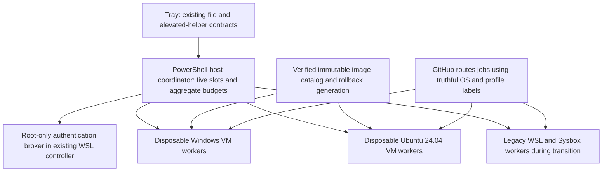

# GitHub runner build parity implementation plan

Revision 2 — 2026-10-18. **Planning only; no implementation or rollout started.**

## Outcome and evidence standard

A supported workflow that succeeds on the selected GitHub-hosted Windows or Ubuntu
baseline must build, link, run its supported tests and package on this rig with the
same project commands, features, dependency declarations, setup actions and source.
Only routing and explicitly documented rig enhancements may differ. A green version
probe or a popular-tool subset is insufficient. Every required upstream inventory
entry and every required behavioral check must be accounted for without unexplained
failure, skipped requirement or silent package omission.

The initial certified profiles are **native Windows Server 2025 / Visual Studio
2026 x64** and **Ubuntu 24.04 x64**. Use explicit profile/image generations, not
moving `windows-latest` or `ubuntu-latest` labels. P01 captures the actual hosted
Set up job image identity; a label cannot select an arbitrary historical hosted VM.
Windows 2022 and other OS/architectures require their own baseline/build/certificate
items before they are advertised. Do not imply they are covered by these two profiles.

Build-service equivalence includes tool versions/defaults, SDKs, tool caches,
shells/environment, supported system services/container behavior, package acquisition,
guest privileges, Actions setup/cache/artifact operations, cancellation and fresh-job
state. Azure IPs/metadata, GitHub ownership/billing identity and hardware speed are
infrastructure differences; record them rather than falsifying hosted environment
identifiers. Resource limits and zccache may change performance, never correctness.

## Starting point and protected boundaries

- The owner's `Custom-Runner-Build-Reliability-Report-2026-10-18.md` from Downloads
  is an input to this plan. Its image/executor/job-environment distinction, installed
  versus available SDKs, cold dependency acquisition and repeatable project contracts
  are covered by P01/P05/P17/P18/P23 and the acceptance matrix. Preserve the original
  report; it is not copied into this public repository.
- Base `main` and `origin/main` were `ae001a6`. M4 PR [#20](https://github.com/special-place-ai-heaven/aap-runner/pull/20)
  was OPEN at initial planning, with all CI green and head `4c3071a`. It is now
  merged at `47a8ca689547d0a1f960d5c994a7a0ce8767d127`; reconcile those APIs before
  later integration. No live installation was changed by that merge.
- The audit at that head is [github-runner-parity-audit.md](https://github.com/special-place-ai-heaven/aap-runner/blob/4c3071a/docs/github-runner-parity-audit.md).
  Its generic Windows 2025/VS2022 inventory link is not the VS2026 baseline: this
  plan explicitly corrects that selection and requires an actual hosted reference.
- The existing product is a PowerShell host task, Linux WSL controller and minimal
  Sysbox job image. It has no native Windows worker backend or hosted environment
  provisioning. Fresh containers and inner Docker already exist.
- Maximum **five total runner slots**, including legacy/new/warm registered workers;
  never five Linux plus five Windows. Aggregate reservations include resident VM
  overhead and uncertain cleanup, not just busy-job telemetry.
- Preserve job isolation, physical-host headroom, bounded disk/IO, public-repo fork
  guards and owner-controlled deployment. No Ubuntu 26.04, named-pipe tray service,
  Rust Windows service rewrite, autologon, owner-password storage, silent update or
  Authenticode requirement. Existing reviewed file/elevated-helper boundaries remain.
- During planning/development, do not stop/restart/reinstall the live pool, run the
  tray or `wsl -d aap-runner`, inspect real keys/tokens, touch either known vault
  path, or delete Docker volumes. Live installation still requires the owner's
  separate word after reviewed code lands. Disposable lab provisioning also needs
  explicit authorization and a resource budget; mock tests cannot satisfy VM gates.
- Existing `.gitignore`, `.claude/`, `.planning/`, base build outputs, shared caches
  and the owner's benchmark directory are pre-existing property, not cleanup targets.

## Target architecture

Use immutable golden images and disposable native VM workers for both certified
profiles. Keep WSL/Sysbox as an explicitly named legacy compatibility backend during
transition; do not claim that adding packages to it proves full VM equivalence.

The PowerShell coordinator acquires a generation-bound reservation **before** boot
or registration. Its state machine covers creating, ready/listening, busy, draining,
collecting, deleting, quarantined and reconciled states. Lost heartbeat alone does
not release capacity. Existing legacy slots must be adopted into the same accounting
before new profiles register. Default profile counts are configurable within the
single ceiling; the plan does not hardcode a permanent Windows/Linux split.

The existing WSL control distro retains the App private key as root-only. Guests
receive only qualified short-lived runner registration material, preferably one-use
JIT configuration after API compatibility is proved. A registration token is not
automatically one-use. The broker accepts bounded fixed lease/profile requests,
never arbitrary commands or request-selected paths. Secrets stay out of command
lines, inbox/status files, images, transcripts and evidence. Use sanitized fixtures
to verify this; do not read the real key to prove its absence elsewhere.

P02 freezes and demonstrates guest-management transports before providers fan out.
Windows PowerShell Direct and isolated per-clone Linux SSH are candidate mechanisms,
not presumed proven implementations. Confirm credential bootstrap, per-clone identity,
host/guest authentication, replay protection, cleanup and malicious guest-response
handling in an authorized disposable lab. No owner credential, reusable host share or
control-plane secret is supplied to a guest. High guest privilege is confined to
the disposable guest: hosted Windows administrator semantics and Ubuntu sudo are
needed for package/setup compatibility.

Images are built from upstream provisioning **including configuration and tests**,
then assembled with reviewed AAP/cache overlays. Validate the final sealed generation
again. Preserve installer order, reboot boundaries, default-user configuration,
tool-cache markers, environment selection, service defaults, software reports and
generalization. Do not globally prepend every VS/SDK directory if the hosted shell
does not do so; use the same workflow developer-environment step.

Current Windows upstream templates use Azure builders. A local Hyper-V adapter,
lawful guest media/activation, reboots and finalization are substantive work. The
existing 60 GiB Linux work-disk default is not a Windows image budget. Measure base,
replacement, retained rollback, build staging and peak active scratch growth first.
Gate VM creation by measured available CPU/RAM/disk/IO after host and live-job reserve.

## Baselines, zccache and provenance

Initial upstream candidate: `actions/runner-images` commit
`ee1ff4569e381a9649b400338bdc8ceb7e18a80e`. P01 must confirm the selected Windows
VS2026 and Ubuntu image releases against hosted evidence before freezing them.
GitHub documents that rebuilding a historical tag is not guaranteed to reproduce
an image. Record resolved installers and hashes; unavailable/drifting inputs are
visible blockers requiring a reviewed baseline revision and recertification.

The owner confirmed **[zackees/zccache](https://github.com/zackees/zccache)** as the
complete intended sccache replacement. Starting candidate is release **1.15.6**
(Git tag `1.15.6`, not an assumed `v` tag), commit
`15ec9537af0d219e07b72ce2b3f97d5f68d72b5e`.

Existing owner-tested Linux x86_64 musl binary, read-only metadata recorded here:

- Path: `C:\temp\aap-cache-benchmark-2026-10-18\bin\zccache`
- Size: 27,876,808 bytes
- SHA-256: `f97ae874042ab5c80fc2e35342e406972437f1fd45ec81372be33c0f5cbb18cc`

The existing file was hashed, not executed for this plan. This is candidate evidence,
not proof that the unpacked file matches a verified upstream release archive or that
Windows is qualified. **Preserve the entire benchmark directory.**

The pinned [feature matrix](https://github.com/zackees/zccache/blob/1.15.6/docs/FEATURE-MATRIX.md)
marks native MSVC `cl.exe`/`link.exe` integration partial. P04 qualifies each compiler
and invocation; unqualified/unsupported modes use tested direct compilation with
caching disabled. Full build parity must work without a wrapper. No sccache fallback,
blind variable rename, old-format reuse or manager-side raw oldest-file eviction.
Use qualified daemon retention and account for metadata/log/temp bytes as well as
artifact bytes. Cross-trust mutable cache/index sharing and hardlink materialization
require poisoning and concurrency proof before enabling; default to isolated roots
and safe copy/reflink behavior where supported.

## Execution order and parallel work

[ledger.json](ledger.json) is the authoritative task/dependency/ownership source;
[LEDGER.md](LEDGER.md) contains the worker briefs. It has **29 top-level items**, all
NOT_STARTED. A wave is an earliest launch group, not permission to ignore dependencies.
At most three worker agents run alongside the coordinator; at most two compile-heavy
jobs and one full test suite run at once. Image builds/IO-heavy tests get a separate
single-token lane and approved hardware budget. Prefer separate approved build/lab
hosts while the owner's pool is busy.

1. **P00 → P01 → P02:** establish cleanup/lease automation, pin baselines and freeze
   interfaces/security/resource decisions. No parallel worker invents a shared schema.
2. **Parallel after contracts:** acquisition, zccache qualification, comparison harness,
   auth broker and capacity allocator. Dispatch up to three disjoint ready leaves.
3. **Parallel providers/builds/probes:** Windows and Ubuntu images/backends, cache
   bundle and workload fixtures, each in its own worktree and owned directory.
4. **Guest and existing-code integration:** guest startup, host contracts and legacy
   migration. Existing manager/helper/installer/tray files have explicit serialized
   owners. Root lockfiles and shared schema/docs are never opportunistically edited.
5. **Convergence:** final image assembly, privileged installer, dual-profile tray,
   mixed-fleet security/reset/fault tests and safe consumer preparation. Keep normal
   production routing unchanged until authorized canary profiles are available.
6. **Certification → independent review → authorized canary → full handoff.** An
   inventory-only, mock-only or Windows-cross-compile-only result cannot promote.

Each leaf is a coherent reviewed PR. Split an oversized leaf into named children
before dispatch if its scope cannot be reviewed safely; amend dependencies and
ownership centrally, never create an untracked side task. P23 expands one exact
preparation child per selected consuming repository; P27 has separate activation
children after canary availability. P26 repairs also receive linked child
items and invalidate affected certificates. Parent items stay incomplete until all
mandatory children are agent-merged and cleaned.

Expand required children before dispatch; their dependencies target complete
external prerequisites, not their own parent. Parent summary PRs become merge-ready
only after child merges and cleanup. Delegate disjoint ownership subsets centrally;
parent and child never hold overlapping write leases.

Every agent is model-pinned with `fork_turns=none`, receives the shared contracts,
its one brief and ownership, and is told it is not alone and must not revert others.
Use the lowest sufficient lane recorded in the ledger; escalate only on concrete
failure evidence. The coordinator routes and independently verifies; it does not
silently become an implementation worker.

## Hard merge-and-clean discipline

The owner clarified that agents handle routine merges. This supersedes the initial
owner-only merge instruction. Review/check gates and the separate requirement for
explicit live-installation approval remain in force.

Each task has a branch, one implementation worktree, any registered verification
worktree, a unique target/temp root and a resource manifest. **No build in base main,
no shared Cargo target, no unregistered temporary environment.**

`VERIFIED → REVIEWED → PR_OPEN → READY_TO_MERGE → MERGED_CLEANUP_REQUIRED → CLEANUP_VERIFIED → COMPLETE`

Agents merge after independent review and required checks pass. Agents never
force-push, reset or stash user work. At the
first observed merge, close the **global no-new-dispatch barrier**. No agent starts
another ledger item and no dependent advances until every merged item has a verified
cleanup receipt. Already-running independent items may finish their existing work;
they cannot claim a follow-up. Clean each merged item before the next merge/claim.
Cleanup and recovery of the current item remain allowed while the barrier is closed.

Verify merge identity including squash/rebase cases, retain compact evidence, stop
only manifest-owned jobs, validate literal paths/reparse boundaries, remove owned
targets/temp/staging/guest artifacts, remove the clean worktree normally, delete its
safe local branch, synchronize main safely and independently prove residue absence.
Any failure is **HOLD** with the barrier closed. Never `git clean -fdx`, forced
worktree removal, broad process killing, recursive deletion of computed unchecked
paths, Docker-volume deletion, or shared/user-cache deletion. See
[WORKTREES.md](WORKTREES.md) for the executable specification and negative tests.

Product images, explicitly retained rollback generations, product cache and small
durable evidence are accounted assets with named owners/retention. They are not
disposable leftovers. Anonymous targets, installers, SDK downloads, clone disks and
logs cannot hide under an evidence-retention excuse.

## Approval and readiness gates

This document is a plan, not authorization to execute it. Record these gates before
the affected task starts; missing facts do not block independent planning work.

| Gate | Required evidence | Blocks |
| --- | --- | --- |
| D0 | Owner authorizes implementation; P00 cleanup tests and its merge/cleanup complete | All later implementation dispatch |
| D1 | M4 PR20 agent-merged, actual main API/schema reconciled | P02 shared consumers and later installer/tray integration |
| D2 | Approved disposable lab/build host, Hyper-V capabilities, lawful guest media/source and activation path, bounded compute/storage budget | Transport proof and actual VM/image tests; never satisfied by Windows 11 ownership alone |
| D3 | Exact hosted baseline image/release and retrievable inputs/source restrictions recorded | Image promotion and comparison evidence |
| D4 | zccache release artifacts verified and per-platform compiler matrix measured | Enabling cache wrappers for that mode; direct compiler path stays required |
| D5 | Owner explicitly approves canary/cutover plan after all prior evidence and cleanup | Any change to the live installation |

Do not purchase services/media, enable host features, alter networking, create test
VMs or dispatch paid reference workloads merely because a plan mentions them.
Before cutover, existing jobs finish naturally; do not use the manager's SIGTERM
path as a drain. Rehearse rollback in the lab before asking for live approval.

## Completion and maintenance

[ACCEPTANCE.md](ACCEPTANCE.md) defines inventory, actual job-process, native build,
Actions integration, cache, isolation, fault, resource and cleanup oracles. Each
implementation PR supplies executable checks and negative controls for its own
outputs. The independent verifier reruns them at the exact final head and records
image/fixture/input identities. A changed head or image invalidates stale evidence.

Completion requires every mandatory leaf and consumer child accepted, agent-merged
where applicable and cleanup-verified; both final profiles certified; no unresolved
required behavioral/inventory difference; approved staged rollout and rollback proof;
and no disposable worktree/target/process/temp residue. Updates rerun certification
and promote only new admissions; running jobs finish on their generation.

## References

- [Pinned image source](https://github.com/actions/runner-images/tree/ee1ff4569e381a9649b400338bdc8ceb7e18a80e)
- [Windows VS2026 builder](https://github.com/actions/runner-images/blob/ee1ff4569e381a9649b400338bdc8ceb7e18a80e/images/windows/templates/build.windows-2025-vs2026.pkr.hcl)
- [Windows VS2026 inventory](https://github.com/actions/runner-images/blob/ee1ff4569e381a9649b400338bdc8ceb7e18a80e/images/windows/Windows2025-VS2026-Readme.md)
- [Ubuntu 24.04 builder](https://github.com/actions/runner-images/blob/ee1ff4569e381a9649b400338bdc8ceb7e18a80e/images/ubuntu/templates/build.ubuntu-24_04.pkr.hcl)
- [Ubuntu inventory](https://github.com/actions/runner-images/blob/ee1ff4569e381a9649b400338bdc8ceb7e18a80e/images/ubuntu/Ubuntu2404-Readme.md)
- [Hosted lifecycle/privileges](https://docs.github.com/en/actions/reference/runners/github-hosted-runners)
- [Self-hosted connectivity and runner maintenance](https://docs.github.com/en/actions/reference/runners/self-hosted-runners)
- [Pinned zccache interface and matrix](https://github.com/zackees/zccache/tree/1.15.6)
